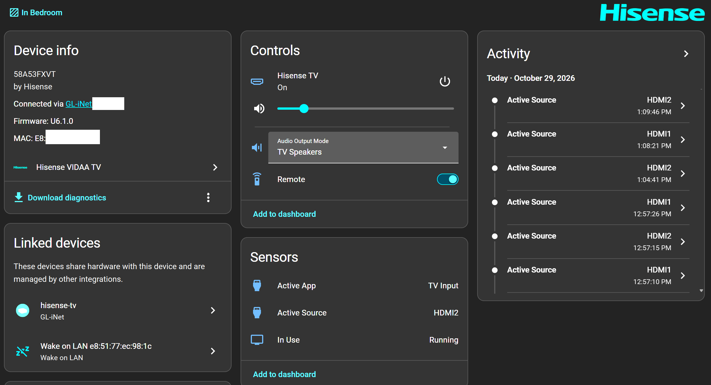

# VIDAA Smart TV Integration for Home Assistant

  
  
  
  
  
  
  

A native Home Assistant integration for smart TVs and projectors running **VIDAA OS** (Hisense, Toshiba, Loewe, Philips, Sharp, JVC, TOPTRO, and partner brands).

Connects **directly** to the TV's internal MQTT broker (TLS port `36669`) using client certificates, providing instant local push updates, media player controls, app launching, Wake-on-LAN, and virtual remote navigation without external bridges or cloud dependencies.

  

---

## 🔰 Quick Start (Beginners Guide)

Setting up your TV takes less than 3 minutes across 3 simple steps:

### 1️⃣ Install via HACS
Click the one-click button below (or search **VIDAA Smart TV** in HACS → Integrations → Download):

### 2️⃣ Place the Key File (`El.p12`)
VIDAA TVs enforce mutual TLS on port 36669. Drop the universal **`El.p12`** file into your Home Assistant **`/config/ssl/`** directory.
- Download the free public **VIDAA Smart TV** app APK on your PC/Mac browser, rename `.apk` to `.zip`, and extract `res/El.p12`.
- *No Android phone, tablet, or emulator is needed!* An `.apk` is simply a standard zip file.

> [!TIP]
> **Need a step-by-step walkthrough?**  
> See the **[Beginner's Quick Start Guide](docs/quick_start_beginners.md)** for detailed instructions with screenshots and zero terminal commands. (For custom PEM keys and OpenSSL commands, see the [Advanced SSL Guide](docs/certificates.md)).

### 3️⃣ Pair with On-Screen PIN
1. Restart Home Assistant (`Settings` → `System` → `Restart`).
2. Go to **Settings → Devices & Services → Add Integration** and search for **Hisense VIDAA TV**.
3. Enter your TV's local IP address and click **Submit**.
4. Type the **4-digit PIN** displayed on your TV screen to complete setup!

---

## 📺 Supported TV Brands & Models

This integration officially supports **any smart TV running VIDAA OS** (pairing via **4-Digit Screen PIN**):

- 📺 **Hisense** (U6, U7, U8, UX, A6, A7 series — U4 to U8, 2018 to 2026+ builds)
- 📺 **Toshiba** (C350, M550, Z670 VIDAA editions)
- 📺 **Loewe** (We. SEE, stellar VIDAA OS series)
- 📺 **Philips / TPV** (OLED, The One, PUS series running VIDAA OS)
- 📺 **Sharp & JVC** (Aquos & Smart TV VIDAA editions)
- 📽️ **TOPTRO** (FreeStyle & portable smart projectors running VIDAA OS)
- *...and other licensed VIDAA OS partner brands.*

> 💡 **Universal Architecture**: All VIDAA OS devices share the same internal broker and certificate authority (`RemoteCA`). The integration features **zero-configuration auto-detection** (querying UPnP `<modelDescription>` on port 38400 or certificate filename hints) to resolve your TV or projector brand, apply the correct security salt, and configure the proper manufacturer in Home Assistant's Device Registry. See the **[Complete OEM Brand Reference Matrix](docs/protocol_architecture.md#%EF%B8%8F-multi-brand-vidaa-os-ecosystem--oem-licensing)** for the full table of all 22+ supported partner brands.

> [!NOTE]
> **VIDAA OS vs Android TV / Google TV**:
> This integration is specifically for televisions powered by **VIDAA OS** (embedded Linux).
> If your TV or projector runs **Android TV** or **Google TV** (such as North American Hisense Android models, Sony, TCL, Chromecast, or NVIDIA Shield):
> - **Basic Remote Control**: Use Home Assistant's core [Android TV Remote](https://www.home-assistant.io/integrations/androidtv_remote/) integration for standard directional navigation and volume control.
> - **Advanced Control & Diagnostics**: Check out [**ADB mDNS**](https://github.com/stevene1919/adb_mdns/) for direct OS shell access (`dumpsys`, `am`), dynamic HDMI-CEC input discovery, real-time on-screen keyboard detection, hardware SoC health sensors (CPU/RAM/storage), and reboot-proof dynamic mDNS tracking.

---

## ✨ Features

- **100% Local LAN Control (`iot_class: local_push`)**: Connects directly to the TV's hardware MQTT broker over your local network with **zero cloud dependencies**, zero external API calls, and full support for isolated IoT VLANs (WAN blocked). All cryptographic authentication logic is implemented in **100% native Python** with zero compiled binary dependencies.
- **Local Push Updates**: Instant feedback for power state, volume, mute, source input, and active app.
- **Media Player Platform**: Full power toggle, volume stepping, input source switcher, dynamic app artwork, deep linking, and configurable media transport controls. Exposes `MediaPlayerDeviceClass.TV` for native Apple HomeKit and iOS Control Center virtual remote integration. Includes **context-aware track controls** (steps channels on Live TV, skips tracks on apps/HDMI), channel name tuning via `play_media`, and user-customizable source list filtering (`CONF_SOURCES`).
- **Pluggable Turn-On Automations (`device_trigger`)**: Intercepts `media_player.turn_on` via standard Home Assistant `PluggableAction` triggers, enabling custom power-on sequences (smart plugs, relays, IR blasters) with automatic fallback to native WoL and MQTT power keys.
- **Dedicated Remote Platform**: Fast key command dispatching, key aliases (`home`, `menu`, `back`, `ok`, etc.), configurable repeat counts, and inter-key delay options.
- **Picture & Display Adjustments (`number` & `select`)**: Fine-tune Backlight, Brightness, and Contrast slider entities (0–100) and switch Picture Modes (`Standard`, `Cinema Day`, `Cinema Night`, `Dynamic`, `Sports`, `Game`, `Filmmaker Mode`) dynamically.
- **Sound Mode Selector (`select`)**: Switch real-time TV sound equalizer modes (`Standard`, `Theatre`, `Music`, `Speech`, `Late Night`, `Sports`) and audio output routing (`select.{tv}_audio_output`).
- **Subnet Wake-on-LAN**: Reliable, multi-burst WoL magic packet dispatching with configurable subnet broadcasting across dual-NIC and VLAN networks.
- **Tabbed Options Flow**: Beautiful, categorized options menu (General & Power, Sources & Media, Remote Key Timings, Security & Brand) for adjusting settings without re-pairing.

---

## 📚 Complete Documentation & Guides

For deep technical details, configuration parameters, and dashboard templates, refer to the dedicated documentation library:

| Guide | Description |
| :--- | :--- |
| 🔰 **[Beginner's Quick Start Guide](docs/quick_start_beginners.md)** | 3-minute, zero-jargon setup guide for first-time users (extracting `El.p12` and pairing). |
| ⚙️ **[Configuration & Options Parameters](docs/parameters.md)** | Complete reference for all initial setup fields and Options Flow parameters across all tabs. |
| ⚡ **[TV Power, Standby & Network Settings](docs/power_and_standby_settings.md)** | Model settings (VIDAA U4–U8, 2024+), two-tier standby architecture, and preventing token loss. |
| 📱 **[Lovelace Remote Cards & Dashboards](docs/lovelace_cards.md)** | Australian EN2G30H 12-app remote, Classic FTA, Button Card, and Android TV Card templates. |
| 🛠️ **[Services & Automation Examples](docs/services_and_automations.md)** | Ready-to-use YAML automations for movie modes, picture/sound toggling, and keyboard input. |
| 🔒 **[Advanced SSL Certificate Setup](docs/certificates.md)** | Mutual TLS file placement, filename matrix, custom PEM keypairs, and OpenSSL reference. |
| 🌐 **[Network & Wake-on-LAN Requirements](docs/network_requirements.md)** | 100% local LAN architecture, UPnP LAN control, IoT VLAN rules, and reliable wired WoL setup. |
| 🧪 **[CLI Testing & Diagnostic Tools](docs/cli_tools.md)** | Standalone [`scripts/test_client.py`](scripts/test_client.py) and [`scripts/debug_tv.py`](scripts/debug_tv.py) command-line tool reference. |
| 🔬 **[Protocol & Cryptographic Architecture](docs/protocol_architecture.md)** | Reverse-engineered UPnP LAN control, XOR bitmasks, token lifecycles, and multi-brand ecosystem. |
| 🛠️ **[Advanced Installation & Lifecycle](docs/installation_advanced.md)** | Git cloning, submodules, air-gapped VLAN installs, and clean uninstallation. |
| 🩺 **[Troubleshooting & Error Reference](docs/troubleshooting.md)** | Diagnostic procedures, error recovery, pairing resets, and action error resolutions. |
| 🖼️ **[Screenshots & UI Gallery](docs/screenshots.md)** | Full visual tour of device controls, media player dialogs, source dropdowns, and option menus. |

---

## ⚡ Integration Actions & Services

The integration exposes dedicated Home Assistant actions for automations, scripts, and dashboard buttons:
- **Remote Navigation & Playback**: `send_key`, `send_key_sequence` (multi-key sequences with delays), and `change_channel` (direct numeric live TV channel tuning).
- **App Launching**: `launch_app` (by name, app ID, or video deep-link URL).
- **Picture & Sound Modes**: `set_picture_setting` and `set_sound_setting` (direct hardware mode changes).
- **Virtual Keyboard**: `send_text_input` (inject search queries into onscreen inputs).

> For copy-paste YAML automation recipes, key tables, and service parameters, see the **[Services & Automations Guide](docs/services_and_automations.md)**.

---

## 🛠️ Diagnostics & CLI Utilities

Standalone CLI tools ([`scripts/test_client.py`](scripts/test_client.py) and [`scripts/debug_tv.py`](scripts/debug_tv.py)) are available to test network reachability, verify TLS certificates, probe TV capabilities, and generate pre-formatted report blocks for GitHub issues without running Home Assistant. See the **[CLI Testing & Diagnostic Tools Guide](docs/cli_tools.md)**.

---

## 📋 Roadmap & Backlog

See [`TODO.md`](TODO.md) for active development items, planned enhancements, and feature requests.

---

## 🌟 Other Integrations

- 📺 [**ADB mDNS - Android Debug Bridge**](https://github.com/stevene1919/adb_mdns/): For smart TVs or streaming boxes running Android TV / Google TV. While Home Assistant's core integration covers basic remote keys, ADB mDNS unlocks advanced capabilities over native TLS 1.3 Wireless Debugging—including full shell execution, dynamic HDMI-CEC device discovery, keyboard active sensing, hardware telemetry, and reboot-proof dynamic mDNS tracking.

---

## ☕ Support the Project

If this integration makes your smart home better or saved you hours of troubleshooting, consider supporting continued reverse-engineering, maintenance, and new features:

  

---

## 🤝 Credits & Acknowledgments

This integration is an independent implementation built upon foundational protocol reverse-engineering research and documentation by the open-source smart home community (including `mqtt-hisensetv` and community research into the Hisense RemoteNOW and VIDAA MQTT protocol).
