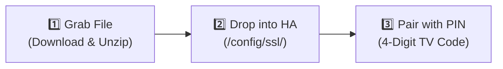

# 🔰 Beginner's Quick Start Guide: Set Up in Under 3 Minutes

Welcome! This guide is designed for **first-time users and beginners**. It skips the complex technical jargon and OpenSSL commands so you can get your smart TV running in Home Assistant as quickly and easily as possible.

> [!NOTE]
> ### 📺 Works With ALL VIDAA OS Brands
> Whether your TV is badged as **Hisense, Toshiba, Loewe, Philips, Sharp, or JVC**, if it runs **VIDAA OS**, this exact same setup works for you! All VIDAA TVs share the exact same internal broker and use the exact same certificate file.

---

## 🎯 What You Will Need

1. **A computer with a web browser** (Windows, Mac, or Linux).
2. **Access to your Home Assistant files** (via the **File Editor** add-on, **Studio Code Server**, or a **Samba / Windows Share**).
3. **Your TV turned on and connected to the same Wi-Fi / home network** as Home Assistant.

> [!IMPORTANT]
> **No Android Phone or Tablet Required!**  
> We only download the free mobile app package because Hisense bundled the TV's communication key inside it. An `.apk` file is just a standard `.zip` file—you can open it on your PC or Mac without owning or using Android.

---

## 🚀 3 Simple Steps



---

### Step 1: Download & Extract the Certificate File (`El.p12`)

1. On your computer (PC, Mac, or laptop), open your web browser.
2. Go to a public mirror site (like [APKMirror.com](https://www.apkmirror.com/apk/vidaa-usa-inc/vidaa-smart-tv/)) and download the free **VIDAA Smart TV** app:
   - Search: **VIDAA Smart TV** (by *VIDAA USA, Inc.*)
   - Download the `.apk` file (it is completely free).
3. Extract the key file:
   - **On Windows**:
     1. Right-click the downloaded file and rename the ending from `.apk` to `.zip` (e.g., `app.apk` ➔ `app.zip`).
     2. Double-click `app.zip` to open it.
     3. Open the `res` folder.
     4. Copy the file named **`El.p12`** to your desktop.
   - **On Mac**:
     1. Rename `.apk` to `.zip` and double-click to unzip it.
     2. Open the `res` folder and copy **`El.p12`**.
   - **On Linux / Home Assistant Terminal**:
     ```bash
     unzip -j com.universal.remote.multi.apk res/El.p12 -d /config/ssl/
     ```

*(If you ever see `3R.p12` instead of `El.p12` in a newer version, that works too!)*

---

### Step 2: Put `El.p12` into Home Assistant

Copy your **`El.p12`** file into your Home Assistant **`/config/ssl/`** folder:

- **Using the File Editor Add-on**:
  1. Open the File Editor in Home Assistant.
  2. Navigate into the `ssl` folder (inside `/config/`). If `ssl` doesn't exist, create it.
  3. Click the **Upload** button (top right) and select `El.p12` from your computer.
- **Using Samba / Windows Network Share**:
  1. Open your Home Assistant shared network drive on your PC.
  2. Open the `ssl` folder and paste `El.p12` inside.

*Home Assistant automatically extracts the certificates from `El.p12` on the fly—no passwords or conversion commands needed!*

---

### Step 3: Add the Integration & Enter Your Screen PIN

1. **Restart Home Assistant**:
   - Go to **Settings → System** and click **Restart** (top right).
2. **Add the Integration**:
   - Go to **Settings → Devices & Services**.
   - Click the blue **Add Integration** button in the bottom right corner.
   - Search for **Hisense VIDAA TV** and click it.
3. **Connect to Your TV**:
   - Enter your TV's IP address (e.g. `192.168.1.50`).
   - Leave Auth Profile set to **Auto Detect (Recommended)**.
   - Click **Submit**.
4. **Enter the 4-Digit PIN**:
   - Look at your TV screen—a **4-digit PIN code** will appear!
   - Type that 4-digit code into the prompt in Home Assistant.
   - Click **Submit**.

🎉 **You're all done!** Your TV will appear in Home Assistant with full media controls, volume slider, input source selector, remote navigation, and app launcher.

---

## 💡 Quick Tips for the Best Experience

1. **Turn on "Wake on LAN" in TV Settings**:
   - On your TV remote, open **Settings → Network → Network Management** (or *Advanced Settings*).
   - Turn **Wake on LAN (WoL)** and **Wake on Wi-Fi** to **ON**.
   - This ensures Home Assistant can still turn the TV back on when it is in standby.
2. **Close the Phone App When Pairing**:
   - The TV's internal broker only allows one pairing handshake at a time. If you have the VIDAA mobile app open on your phone, close it before pairing in Home Assistant.
3. **Brand-Specific Names (Optional)**:
   - Home Assistant automatically detects whether your TV is Hisense, Toshiba, Loewe, Philips, Sharp, or JVC. If you want to rename your certificate, you can rename `El.p12` to `toshiba.p12`, `loewe.p12`, etc., and Home Assistant will pick up the hint automatically!

---

## 🆘 Need More Help?

- ⚙️ **Want to customize buttons, sleep timers, and picture modes?** See [Configuration Parameters](parameters.md).
- 📱 **Want a beautiful virtual TV remote card on your dashboard?** See [Lovelace Remote Cards](lovelace_cards.md).
- 🎬 **Want to dim your living room lights when movies play?** See [Services & Automations](services_and_automations.md).
- 🔒 **Are you a network admin needing manual PEM keys or Root CA validation?** See [Advanced SSL Certificate Setup](certificates.md).
- 🩺 **Having trouble connecting?** See the [Troubleshooting Reference](troubleshooting.md).
